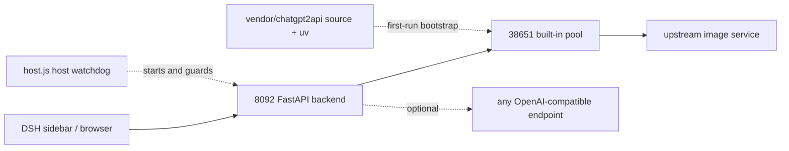

# Bluxe Image Workbench (DSH Plugin)

[简体中文](./README.md) · English

One plugin runs the whole stack: an image-generation workbench with two prompt modes (illustration / photography) inside the DeepSeek Harness (DSH) sidebar. The account-pool server ships inside the plugin, so no second pool plugin is required. The generation endpoint can also be pointed at any OpenAI-compatible service (Base URL / API Key / model).

The backend also runs without DSH. Open `http://127.0.0.1:8092/` in a browser.

> This repository contains code and the built-in style catalog only. No generated images, history, drafts, accounts, tokens, keys, or proxy settings are included.

## Features

| Module | Details |
| --- | --- |
| Two generation modes | Illustration and photography prompt pipelines, with selectable format, style, palette and layout. `server/catalog.json` ships 368 styles, 170 layouts and 36 palettes |
| Reference images | Upload or drop a reference image, sent through `/v1/images/edits`; disable it when the endpoint does not support edits |
| Batch generation | Import storyboard rows in bulk and queue them. A failed image is retried with another account (up to 3 rounds) instead of aborting the whole task |
| Aspect ratios | `1:1`, `3:4`, `2:3`, `9:16`, `4:3`, `3:2`, `16:9`, plus `2.35:1` for WeChat cover images (no native upstream size: generate at the widest size, then center-crop locally) |
| Results | Generation history, drafts, redo a single image, ZIP download, thumbnail/preview derivatives, completion toast |
| Monitoring | Account total / available / quota, per-account failure ledger, queue state |
| Endpoint & pool | Copy the endpoint URL and the local plaintext API key; start / stop / restart the pool and toggle auto-restart; import accounts from JSON or bare tokens, disable / delete accounts, rotate keys |
| Customization | Workbench title, output directory, endpoint name, model, response format, monitoring mode |

## Architecture



| Path | Contents |
| --- | --- |
| `host.js` / `client.js` | DSH host side: starts and guards 8092, sidebar panel, status indicator |
| `install.mjs` | Idempotent installer: registers the profile, syncs backend code, removes the legacy standalone pool plugin |
| `cordis.patch.yml` | DSH loader config (ports, watchdog interval) |
| `server/` | Pure backend code copy: `app.py`, `pool.py`, `pool_service.py`, `pool_admin.py`, `static/index.html`, `catalog.json` |
| `vendor/chatgpt2api/` | Pool server source snapshot + `runtime/uv.exe` + MIT LICENSE + sanitized default config |
| `scripts/vendor-snapshot.py` | Rebuilds the vendored pool snapshot |

Pool ownership and process lifecycle live in `server/pool_service.py`; the host only manages 8092. The writing-workbench pool on port `38650` belongs to a different plugin and is never started, stopped or modified here.

## Getting started

### Requirements

| Requirement | Notes |
| --- | --- |
| DSH desktop | Verified against the `desktop` profile. DSH is optional; see "Running standalone" |
| Node.js >= 20 | Runs `install.mjs` and `host.js` |
| Python | The bundled `uv.exe` provisions Python 3.13 and dependencies on first run; a system Python also works if `server/requirements.txt` is installed manually |
| Network | First-run bootstrap downloads Python and pip packages; the pool usually needs a proxy to reach its upstream |
| OS | Verified on Windows 10 / 11. The vendored `uv.exe` is a Windows binary; on Linux / macOS supply your own uv or a prepared Python environment |

### Install

```bash
git clone https://github.com/guohwa/dsh-plugin-image-workbench.git
cd dsh-plugin-image-workbench
node install.mjs
```

The installer does four things: backs up and updates `dependencies` and `dsh.profile.bundles` in `~/.dsh/profiles/desktop/package.json`, syncs `pnpm-lock.yaml`, creates a directory junction inside the profile's `node_modules`, and removes the legacy standalone pool plugin `dsh-plugin-image-pool` from the load list (config only; its source and account data are kept). It is idempotent.

**Restart DSH** so the bundle loads. Open "Bluxe Image Workbench" from the sidebar, or go to `http://127.0.0.1:8092/` directly.

Keep the plugin directory in place: the profile references it through a junction. After moving it, rerun `node install.mjs`.

### What happens on first launch

1. Pool source is unpacked from `vendor/chatgpt2api/` into the local data directory; no account database is copied.
2. The bundled uv runs `sync --frozen --no-dev` to build the pool venv, then provisions the backend venv (Tsinghua PyPI mirror).
3. `127.0.0.1:38651` starts and an `admin-key` plus the first user API key are issued.
4. Statistics are reconciled as soon as the pool is up, so the header never sits at "1 account / quota 0".
5. Two watchdogs start: the host probes 8092 every 15 seconds, the backend probes 38651 every 15 seconds. Both restart on failure without reloading the page.

First-run bootstrap takes roughly 20 seconds to 1 minute, depending on whether Python 3.13 is already cached locally.

### Before generating: pick one

A fresh pool has **no accounts**, so generating immediately will fail. Choose one path:

**A. Use the built-in pool**

Open "Endpoint & Pool -> Local Pool", click Choose File to upload `txt` / `json` / `csv` files (multi-select and drag-and-drop supported), or paste the content directly, then click Import & Check. Supported formats:

- JSON exported from the pool or another tool (`{"accounts":[...]}`, an array, or a single object). Recommended: it keeps the email/password material needed for automatic re-login after token expiry.
- One `access_token` per line (`eyJ...` strings).
- Legacy export lines (`email,password,token` or `email----password----token`).

Account material without a token (`email----password----2FA secret`) cannot be exchanged for a token by this pool version; export with `access_token` instead.

Then configure an outbound proxy for your network, confirm the panel shows the pool online, and generate.

**B. Use a third-party endpoint**

Open "Endpoint & Pool -> Generation Endpoint", fill in Base URL / API Key / model, save and test. The built-in pool is not needed on this path.

## Running standalone (without DSH)

The backend starts and guards the pool itself, so only the backend needs to run:

```bash
cd server
python -m venv .venv
# Windows
.venv/Scripts/pip install -r requirements.txt
.venv/Scripts/python -m uvicorn app:app --host 127.0.0.1 --port 8092
# Linux / macOS
# .venv/bin/pip install -r requirements.txt
# .venv/bin/python -m uvicorn app:app --host 127.0.0.1 --port 8092
```

`pool_service.py` still unpacks the pool runtime from the plugin's `vendor/` and initializes it with the bundled uv. On Linux / macOS, prepare a Python 3.13 environment for the pool if no uv is available. Then open `http://127.0.0.1:8092/`.

## Configuration

Most settings live in "Endpoint & Pool -> Generation Endpoint" and are written to `server/config.local.json` (not committed).

| Setting | Default | How to change |
| --- | --- | --- |
| Workbench port | `8092` | `port` in `cordis.patch.yml`, or `DSH_IMAGE_PORT` |
| Pool port | `38651` | `poolPort` in `cordis.patch.yml`, or `DSH_IMAGE_POOL_PORT` |
| Base URL | `http://127.0.0.1:38651/v1` | Generation Endpoint tab |
| Image model | `gpt-image-2` | Generation Endpoint tab |
| Output directory | `server/images/` | Generation Endpoint tab, absolute paths accepted |
| Workbench title | `Bluxe手绘工坊 · 生图工作台` | Generation Endpoint tab |
| Pool data directory | `~/.dsh/chatgpt2api-image/` | Shown in the Local Pool tab; holds `admin-key`, `user-api-keys.json`, `source/config.json` and the account database |
| Watchdog interval | `15000` ms | `watchdogIntervalMs` in `cordis.patch.yml`; `watchdog: false` disables the host watchdog |
| Logs | `~/.dsh/image-workbench/backend.log`, `~/.dsh/image-workbench/venv.log`, `pool-service.log` in the pool directory | Check these three first when troubleshooting |

## Accounts and outbound traffic

- Start / Stop / Restart / Auto-restart only affect the local pool addressed by the current Base URL. They are hidden when a third-party endpoint is configured.
- The factory config `vendor/chatgpt2api/source/config.default.json` ships with `auth-key`, `proxy` and `proxy_runtime.proxy_url` empty. After bootstrap, set `proxy` or `proxy_runtime` in `~/.dsh/chatgpt2api-image/source/config.json` to match your network, otherwise the pool stays online but cannot reach its upstream.
- The pool uses strict round-robin account selection and excludes rate-limited accounts. A failed account is recorded in monitoring without aborting the batch.
- The plaintext API key lives only in the local pool directory and the panel. The browser never receives account `access_token` values; it operates on digest ids.

## Data and privacy

- `.gitignore` excludes `images/`, `refs/`, `thumbs/`, `workbench/`, `*.db`, `history.json`, `drafts.json`, `config.local.json`, `user-api-keys.json`, `admin-key`, `*.log` and all `*.bak_*` backups.
- Everything produced at runtime stays on the machine: images, history and drafts under `server/`; accounts and keys in the pool data directory.
- Both services bind to `127.0.0.1` only, and the backend auth layer is a no-op in this local build. **Do not expose 8092 / 38651 to a public or shared network.** Put a reverse proxy and authentication in front if remote access is needed.
- The pool stores the credentials you import. Never sync its data directory to a public location.

## Troubleshooting

| Symptom | Fix |
| --- | --- |
| No sidebar entry | Bundles load only at DSH startup; restart DSH |
| "Built-in pool not ready" | Open "Endpoint & Pool -> Local Pool" and click Start; first run needs about a minute to build the environment |
| Generation returns 401 | Click Regenerate Key in the panel, or check the third-party API key |
| Pool online but generation fails | Usually a missing proxy or exhausted quota; import accounts, set the proxy in `source/config.json`, then read `pool-service.log` |
| Changed `host.js` / `client.js` / `package.json` | Restart DSH; changes to `static/index.html` only need a browser refresh (Ctrl+F5) |
| Legacy pool entry still in sidebar | The installer removed it from the load list; it disappears after restarting DSH |

## Updating the vendored pool and uninstalling

```bash
# Rebuild the vendor snapshot after editing local pool source (no accounts or keys are copied)
python scripts/vendor-snapshot.py

# Remove this plugin from the profile; restart DSH. Data directories are kept.
node install.mjs --uninstall
```

Backend self-check: from `server/`, run `python smoke_check.py --quick` with dependencies installed.

## Third-party code and license

`vendor/chatgpt2api/` is a source snapshot of ChatGPT2API v1.8.0, MIT License, Copyright (c) 2026 kunkun; the full text is in `vendor/chatgpt2api/source/LICENSE`. It retains two patches required by this workbench: persistent round-robin cursor and exclusion of rate-limited accounts. The snapshot supplies runnable code only, never accounts, keys or proxy settings.

The original code in this repository has no separate license declaration yet. Keep the MIT notice inside `vendor/` when redistributing.

Verify the compliance of the upstream project and of any accounts you supply yourself. This project ships no accounts.
