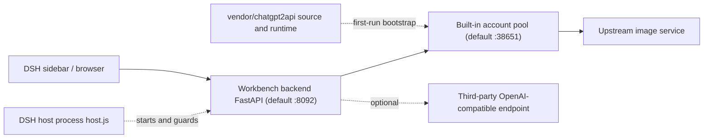

# Bluxe Image Workbench

[简体中文](./README.md) · English · [MIT License](./LICENSE)

An image generation workbench plugin for the DeepSeek Harness (DSH) desktop application. A single distributable package provides the web workbench, a FastAPI backend, and an account-pool runtime, exposing illustration and photography prompt pipelines in the DSH sidebar. The generation endpoint points to the bundled local account pool by default and can be reconfigured to any OpenAI-compatible service.

The backend also operates without DSH. By default, open `http://127.0.0.1:8092/` in a browser.

> This repository contains source code and the built-in format, style, layout and palette catalogs only. Generated images, history, drafts, account credentials, API keys and proxy settings are excluded from version control.

## Contents

- [Capabilities](#capabilities)
- [Architecture](#architecture)
- [Requirements](#requirements)
- [Installation](#installation)
- [First launch](#first-launch)
- [Endpoint setup and account management](#endpoint-setup-and-account-management)
- [Standalone operation](#standalone-operation)
- [Configuration](#configuration)
- [HTTP API](#http-api)
- [Data and privacy](#data-and-privacy)
- [Troubleshooting](#troubleshooting)
- [Maintenance and uninstallation](#maintenance-and-uninstallation)
- [License and third-party code](#license-and-third-party-code)

## Capabilities

| Capability | Details |
| --- | --- |
| Two prompt modes | Illustration and photography pipelines with selectable format, style, palette and layout. `server/catalog.json` ships 368 styles, 170 layouts and 36 palettes |
| Reference images | Upload or drop a reference image, submitted through `/v1/images/edits`; the capability can be disabled when the endpoint does not support edits |
| Batch generation | Import storyboard rows in bulk and queue them. A failed image is retried with another account (up to 3 rounds) without aborting the task |
| Aspect ratios | `1:1`, `3:4`, `2:3`, `9:16`, `4:3`, `3:2`, `16:9`, plus `2.35:1` for WeChat cover images. When no native upstream size exists, the image is generated at the widest supported size and center-cropped locally |
| Result management | Generation history, drafts, single-image redo, ZIP download, thumbnail and preview derivatives, completion notifications |
| Monitoring | Total, available and quota figures for accounts, per-account failure ledger and queue state; one-click stop for running and queued jobs |
| Endpoint and account pool | Copy the endpoint URL and local API key; start, stop and restart the pool with configurable auto-restart; import accounts (manually removed ones are skipped), disable and delete accounts, rotate keys |
| Customization | Workbench title, output directory, endpoint name, model, response format and monitoring mode |

## Architecture



| Component | Responsibility |
| --- | --- |
| `host.js` / `client.js` | DSH host entry point: starts and guards port 8092, renders the sidebar panel and status indicator |
| `install.mjs` | Idempotent installer: registers the profile, syncs backend code, cleans up registration on uninstall |
| `cordis.patch.yml` | DSH loader configuration: service ports, watchdog toggle and probe interval |
| `server/` | Backend code, static interface and format/style catalogs |
| `vendor/chatgpt2api/` | Account-pool server source snapshot, `uv` runtime, sanitized default configuration and upstream license |
| `scripts/vendor-snapshot.py` | Rebuilds the vendored source snapshot |

The account-pool process lifecycle is managed by `server/pool_service.py`; the DSH host process manages only the workbench backend on port 8092. The pool runtime ships with the plugin and requires no external account-pool plugin.

## Requirements

| Item | Requirement |
| --- | --- |
| DSH desktop | Verified against the `desktop` profile. DSH is optional; see [Standalone operation](#standalone-operation) |
| Node.js | 20 or newer, to run `install.mjs` and `host.js` |
| Python | 3.13. The bundled `uv` provisions the runtime and dependencies on first launch; alternatively install a system Python and `server/requirements.txt` manually |
| Operating system | Verified on Windows 10 / 11. `vendor/chatgpt2api/runtime/uv.exe` is a Windows binary; Linux and macOS require a local `uv` or a prepared Python 3.13 environment |
| Network | First-run bootstrap downloads the Python runtime and dependency packages. The pool usually requires an outbound proxy to reach its upstream |

## Installation

### Install from DSH (recommended)

Open "Plugins -> Add Plugin" and use any one of these:

| Method | Enter | Notes |
| --- | --- | --- |
| npm package (preferred) | `dsh-plugin-image-workbench` | Served from a CDN, fast and interruption-free; the plugin manager probes npmjs and npmmirror in parallel and takes whichever answers first |
| Gitee mirror | `https://gitee.com/guohwa/dsh-plugin-image-workbench` | Reachable directly from mainland China, shallow clone takes about 9 seconds |
| GitHub upstream | `https://github.com/guohwa/dsh-plugin-image-workbench` | Source of truth; cloning often stalls on the 31 MB uv runtime |

All three carry the same content: every push and tag on GitHub is mirrored to Gitee, and tags also trigger an npm release. The plugin ships a roughly 31 MB uv runtime, which is exactly the part that stalls or times out when cloning from GitHub — so prefer the package name or the Gitee URL in mainland China.

### Install from source

For development, restricted networks, or migration from an older version:

```bash
git clone https://gitee.com/guohwa/dsh-plugin-image-workbench.git
cd dsh-plugin-image-workbench
node install.mjs
```

Upstream lives on GitHub (`https://github.com/guohwa/dsh-plugin-image-workbench.git`); the Gitee URL above is the same content and much faster from mainland China.

The installer creates the profile directory junction, registers the bundle, syncs backend code and removes the legacy standalone pool plugin from the load list. It is idempotent. DSH usually picks up the new bundle directly; if no sidebar entry appears, quit DSH completely and start it again.

> Do not move or delete the installation directory. The profile stores a junction pointing at it, and DSH cannot resolve the plugin once the directory moves. To relocate, run `node install.mjs --uninstall` in the old directory first, then install from the new one. Re-running the installer also repairs a junction that still points at an old path.

Open "Bluxe手绘工坊 · 生图工作台" from the sidebar, or navigate directly to `http://127.0.0.1:8092/`.

## First launch

The first launch prepares the backend and account-pool runtime automatically and is usually ready within a minute, with no manual steps required. The pool then starts on its own, and can also be started from "Endpoint & Pool -> Local Pool".

## Endpoint setup and account management

A fresh pool contains no accounts. Complete one of the following configurations before the first generation.

### Option A: Use the built-in account pool

Import accounts under "Endpoint & Pool -> Local Pool". Click the file selector or drop `.txt`, `.json`, `.csv`, `.tsv` or `.log` files into it (multi-select supported), or paste the content directly, then click the import button.

| Format | Details |
| --- | --- |
| JSON export | `{"accounts":[...]}`, an array, or a single object. Retains email, password and related account material for automatic re-login after token expiry; recommended |
| Five-field bulk format | `email----password----client_id----mail_refresh_token----access_token`. The mailbox client ID and mailbox refresh token are stored with the account as reference data and are never used as the pool's OpenAI `refresh_token` |
| Plain-text tokens | One `access_token` per line (`eyJ`-prefixed strings) |
| Legacy export lines | `email,password,token` or `email----password----token` |

Entries containing only an email, password and 2FA secret without an `access_token` are not supported; this pool version does not perform login-to-token exchange. After import, configure an outbound proxy for the network environment and confirm that the panel reports the pool as online.

### Outbound proxy

The built-in pool must reach OpenAI / ChatGPT. Leave it empty for a direct connection on an unrestricted network; on a restricted network configure it as below. The address shown in the panel is always what was detected on this machine, never a hardcoded sample.

- **Auto-detected display**: "Endpoint & Pool -> Local Pool -> Pool outbound proxy" shows the proxy this machine is actually using. Environment variables such as `HTTPS_PROXY` are read first (temporary loopback proxies injected by host tools are ignored), then common local ports are probed: 1080 (both SOCKS5 and HTTP), 7890, 7891, 8118, 1087. Change machine or proxy port and the value follows.
- **Auto-calibration**: the pool calibrates once at startup. A saved address that still connects locally is kept; one that no longer connects (new machine, closed port, exited client) is re-detected and replaced; nothing found means a direct connection.
- **Manual entry / one-click switch**: you can also type your own address and click "Save proxy" to run an immediate connectivity check; failures name the address that could not be reached, and account quotas are recalculated once it passes. If the saved address is unreachable on this machine, the panel marks it and offers a "switch to <address>" button.
- Environment variable: set `CHATGPT2API_PROXY_RUNTIME_PROXY_URL` (e.g. `socks5://127.0.0.1:1080`) before launch; the pool reads it during bootstrap.

With a proxy configured, the pool reaches its upstream through that egress and generation succeeds. Without one on a restricted network, the panel shows online but generation fails with connection timeouts in the log, and account quotas stay at 0 (displayed as "used up").

### Option B: Use a third-party endpoint

Under "Endpoint & Pool -> Generation Endpoint", enter the Base URL, API key and model name, save, and run the connectivity test. This path does not require the built-in account pool.

## Standalone operation

The backend starts and guards the account pool itself, so only the backend needs to run:

```bash
cd server
python -m venv .venv
```

```bash
# Windows
.venv/Scripts/pip install -r requirements.txt
.venv/Scripts/python -m uvicorn app:app --host 127.0.0.1 --port 8092

# Linux / macOS
# .venv/bin/pip install -r requirements.txt
# .venv/bin/python -m uvicorn app:app --host 127.0.0.1 --port 8092
```

`pool_service.py` still unpacks the pool runtime from the plugin's `vendor/` directory. On Linux and macOS, prepare a Python 3.13 environment for the pool if no `uv` is available. Then open `http://127.0.0.1:8092/`.

## Configuration

Most settings are available under "Endpoint & Pool -> Generation Endpoint" and are written to `server/config.local.json`, which is not committed. The table below lists factory defaults; both service ports can be changed through `cordis.patch.yml` or environment variables. When changing the pool port, update the generation endpoint Base URL accordingly. The account management panel is verified against the default port 38651, so retaining the default is recommended.

| Setting | Default | How to change |
| --- | --- | --- |
| Workbench port | `8092` | `port` in `cordis.patch.yml`, or `DSH_IMAGE_PORT` |
| Pool port | `38651` | `poolPort` in `cordis.patch.yml`, or `DSH_IMAGE_POOL_PORT` |
| Base URL | `http://127.0.0.1:38651/v1` | Generation Endpoint tab |
| Image model | `gpt-image-2` | Generation Endpoint tab |
| Output directory | `server/images/` | Generation Endpoint tab; absolute paths accepted |
| Workbench title | `Bluxe手绘工坊 · 生图工作台` | Generation Endpoint tab |
| Pool data directory | `~/.dsh/chatgpt2api-image/` | Holds `admin-key`, `user-api-keys.json`, `source/config.json` and the account database |
| Watchdog interval | `15000` ms | `watchdogIntervalMs` in `cordis.patch.yml`; `watchdog: false` disables the host-side watchdog |
| Logs | `~/.dsh/image-workbench/backend.log`, `~/.dsh/image-workbench/venv.log`, `pool-service.log` in the pool directory | Inspect in this order when troubleshooting |

## HTTP API

Principal backend routes are listed below. The complete definitions are in `server/app.py`.

| Route | Method | Purpose |
| --- | --- | --- |
| `/health` | GET | Backend liveness probe |
| `/api/catalog` | GET | Format, style, layout and palette definitions |
| `/api/config`, `/api/config/test` | GET / POST | Read and update configuration; connectivity test |
| `/api/compose` | POST | Prompt composition |
| `/api/generate` | POST | Submit an image generation task |
| `/api/generate/stop` | POST | Cancel in-flight requests, clear the queue and stop account retries |
| `/api/tasks/{task_id}` | GET | Query task status |
| `/api/history`, `/api/drafts` | GET / POST / DELETE | Generation history and drafts |
| `/api/monitor` | GET | Runtime monitoring data |
| `/api/pool/panel` | GET | Account and key overview |
| `/api/pool/proxy`, `/proxy/test` | GET / POST | Read, save and test the pool's outbound proxy (required on restricted networks; direct by default) |
| `/api/pool/accounts/import`, `/delete`, `/status` | POST | Import, delete and enable/disable accounts |
| `/api/pool/key/ensure` | POST | Reissue a user API key |
| `/api/pool/service` | GET | Pool process status |
| `/api/pool/service/start`, `/stop`, `/restart`, `/auto` | POST | Process control and auto-restart toggle |

## Data and privacy

- `.gitignore` excludes `images/`, `refs/`, `thumbs/`, `workbench/`, `*.db`, `history.json`, `drafts.json`, `config.local.json`, `user-api-keys.json`, `admin-key`, `*.log` and all `*.bak_*` backup files.
- Runtime artifacts stay on the local machine: images, history and drafts under `server/`; accounts and keys in the pool data directory.
- Both services bind to `127.0.0.1` only, and the backend authentication layer is a no-op in this local build. **Do not expose 8092 or 38651 to a public or shared network.** Configure a reverse proxy with authentication if remote access is required.
- The pool stores imported account credentials. Its data directory must not be synced to any public location.

## Troubleshooting

| Symptom | Resolution |
| --- | --- |
| No sidebar entry | Bundles load only at DSH startup; quit DSH completely and start it again |
| Plugin manager reports a GitHub connection timeout | Switch to the Gitee URL `https://gitee.com/guohwa/dsh-plugin-image-workbench`, reachable directly from mainland China |
| Install fails with `ERR_PNPM_EPERM ... rename '...dsh-plugin-image-workbench_tmp_...'` | The previous version is still running and the backend process holds the plugin directory, so Windows refuses the rename. Quit DSH completely (tray menu -> Quit), end any leftover `python.exe` in Task Manager, delete `node_modules\dsh-plugin-image-workbench`, then install again. From 1.1.4 on, installs under `node_modules` relocate their runtime to `~/.dsh/image-workbench`, so this no longer happens |
| Code stops taking effect after moving the installation directory | Re-run `node install.mjs`; the directory junction is rebuilt to the current path |
| "Built-in pool not ready" | Start the pool under "Endpoint & Pool -> Local Pool"; allow time for first-run environment initialization |
| Dependency install reports `fastapi was not found in the package registry` or an index returns 403 | The proxy is blocking the mirror. Sources are tried in order automatically (mirrors direct -> official PyPI via proxy -> official PyPI direct); if all fail, point `DSH_IMAGE_PYPI_INDEX` at a reachable index |
| Repeats `No module named uvicorn` | An empty environment left behind by a failed install. 1.1.2 detects and repairs it automatically; on older versions delete `server/.venv` and restart DSH |
| Account quotas stay at 0 and show "used up" | The outbound proxy is not in effect or the port is wrong. Re-enter the address under "Local Pool -> Pool outbound proxy" and save; the connectivity check runs on save and quotas are recalculated once it passes |
| Generation returns 401 | Reissue the API key in the panel, or verify the third-party endpoint key |
| Pool online but generation fails | Usually a missing outbound proxy or exhausted quota; check the proxy in `source/config.json` and read `pool-service.log` |
| Changed host-side code or profile configuration | Restart DSH; static interface resource changes require a browser cache refresh |
| Legacy pool entry still visible in the sidebar | The installer removed its load-list registration; it disappears after restarting DSH |

## Maintenance and uninstallation

```bash
# Rebuild the vendor snapshot after editing local pool source; no accounts or keys are copied
python scripts/vendor-snapshot.py

# Backend smoke test; run with dependencies installed
cd server && python smoke_check.py --quick

# Update: overwrite the source in place (or git pull), then re-run the installer
node install.mjs

# Remove the plugin from the profile and drop the directory junction; restart DSH
node install.mjs --uninstall
```

Uninstalling removes only the profile registration and the directory junction. The plugin source directory, the account data under `~/.dsh/chatgpt2api-image` and generated images are all preserved; delete them yourself once you are sure they are no longer needed.

The pool uses strict round-robin account selection and excludes rate-limited accounts. A failed account is recorded in monitoring without aborting the batch. Start, stop, restart and auto-restart controls affect only the local pool addressed by the current Base URL and are hidden when a third-party endpoint is configured.

## License and third-party code

Original code in this repository is distributed under the [MIT License](./LICENSE). The bundled account-pool server comes from these upstream projects:

| Layer | Project |
| --- | --- |
| Upstream backend | [basketikun/chatgpt2api](https://github.com/basketikun/chatgpt2api) (`VERSION` = 1.8.0) |
| DSH plugin wrapper | [yang0/chatgpt2api-dsh](https://github.com/yang0/chatgpt2api-dsh) |
| This repository | `vendor/chatgpt2api/`, backend source snapshot only |

The snapshot is distributed under MIT, Copyright (c) 2026 kunkun; see `vendor/chatgpt2api/source/LICENSE`. It includes two patches (persistent round-robin cursor, exclusion of rate-limited accounts) and contains no accounts, keys or proxy settings.

The upstream project states additional restrictions on use; read them there. This repository ships no accounts.
