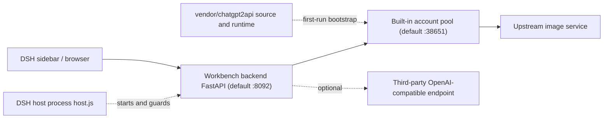

# Bluxe Image Workbench

[简体中文](./README.md) · English · [MIT License](./LICENSE)

An image generation workbench plugin for the DeepSeek Harness (DSH) desktop application. A single distributable package provides the web workbench, a FastAPI backend, and an account-pool runtime, exposing illustration and photography prompt pipelines in the DSH sidebar. The generation endpoint points to the bundled local account pool by default and can be reconfigured to any OpenAI-compatible service.

The backend also operates without DSH. By default, open `http://127.0.0.1:8092/` in a browser.

> This repository contains source code and the built-in format, style, layout and palette catalogs only. Generated images, history, drafts, account credentials, API keys and proxy settings are excluded from version control.

## Contents

- [Capabilities](#capabilities)
- [Architecture](#architecture)
- [Requirements](#requirements)
- [Installation](#installation)
- [First launch](#first-launch)
- [Endpoint setup and account management](#endpoint-setup-and-account-management)
- [Standalone operation](#standalone-operation)
- [Configuration](#configuration)
- [HTTP API](#http-api)
- [Data and privacy](#data-and-privacy)
- [Troubleshooting](#troubleshooting)
- [Maintenance and uninstallation](#maintenance-and-uninstallation)
- [License and third-party code](#license-and-third-party-code)

## Capabilities

| Capability | Details |
| --- | --- |
| Two prompt modes | Illustration and photography pipelines with selectable format, style, palette and layout. `server/catalog.json` ships 368 styles, 170 layouts and 36 palettes |
| Reference images | Upload or drop a reference image, submitted through `/v1/images/edits`; the capability can be disabled when the endpoint does not support edits |
| Batch generation | Import storyboard rows in bulk and queue them. A failed image is retried with another account (up to 3 rounds) without aborting the task |
| Aspect ratios | `1:1`, `3:4`, `2:3`, `9:16`, `4:3`, `3:2`, `16:9`, plus `2.35:1` for WeChat cover images. When no native upstream size exists, the image is generated at the widest supported size and center-cropped locally |
| Result management | Generation history, drafts, single-image redo, ZIP download, thumbnail and preview derivatives, completion notifications |
| Monitoring | Total, available and quota figures for accounts, per-account failure ledger and queue state |
| Endpoint and account pool | Copy the endpoint URL and local API key; start, stop and restart the pool with configurable auto-restart; import, disable and delete accounts; rotate keys |
| Customization | Workbench title, output directory, endpoint name, model, response format and monitoring mode |

## Architecture



| Component | Responsibility |
| --- | --- |
| `host.js` / `client.js` | DSH host entry point: starts and guards port 8092, renders the sidebar panel and status indicator |
| `install.mjs` | Idempotent installer: registers the profile, syncs backend code, cleans up registration on uninstall |
| `cordis.patch.yml` | DSH loader configuration: service ports, watchdog toggle and probe interval |
| `server/` | Backend code, static interface and format/style catalogs |
| `vendor/chatgpt2api/` | Account-pool server source snapshot, `uv` runtime, sanitized default configuration and upstream license |
| `scripts/vendor-snapshot.py` | Rebuilds the vendored source snapshot |

The account-pool process lifecycle is managed by `server/pool_service.py`; the DSH host process manages only the workbench backend on port 8092. The pool runtime ships with the plugin and requires no external account-pool plugin.

## Requirements

| Item | Requirement |
| --- | --- |
| DSH desktop | Verified against the `desktop` profile. DSH is optional; see [Standalone operation](#standalone-operation) |
| Node.js | 20 or newer, to run `install.mjs` and `host.js` |
| Python | 3.13. The bundled `uv` provisions the runtime and dependencies on first launch; alternatively install a system Python and `server/requirements.txt` manually |
| Operating system | Verified on Windows 10 / 11. `vendor/chatgpt2api/runtime/uv.exe` is a Windows binary; Linux and macOS require a local `uv` or a prepared Python 3.13 environment |
| Network | First-run bootstrap downloads the Python runtime and dependency packages. The pool usually requires an outbound proxy to reach its upstream |

## Installation

```bash
git clone https://github.com/guohwa/dsh-plugin-image-workbench.git
cd dsh-plugin-image-workbench
node install.mjs
```

The installer performs the following operations:

- backs up and updates `dependencies` and `dsh.profile.bundles` in `~/.dsh/profiles/desktop/package.json`;
- syncs `pnpm-lock.yaml` and creates a directory junction to the plugin inside the profile's `node_modules`;
- syncs `server/` as the runtime backend code copy;
- removes the registration entry of the legacy standalone account-pool plugin from the load list, modifying configuration only and preserving its data directory.

The installer is idempotent; repeated runs do not duplicate registration entries. DSH bundles are loaded at application startup, so DSH must be restarted after installation for the sidebar entry to appear. The profile references the plugin through a directory junction; rerun the installer after relocating the plugin directory.

Open "Bluxe手绘工坊 · 生图工作台" from the sidebar, or navigate directly to `http://127.0.0.1:8092/`.

## First launch

1. The account-pool source is unpacked from `vendor/chatgpt2api/` into the local data directory; no account database is copied.
2. The bundled `uv` runs `sync --frozen --no-dev` to build the pool environment, followed by the workbench backend environment.
3. `127.0.0.1:38651` starts, and an admin key plus the first user API key are issued.
4. Account statistics are reconciled once the pool is ready, keeping header figures consistent with actual state.
5. Two watchdogs start: the host probes 8092 every 15 seconds and the backend probes 38651 every 15 seconds. Both restart on failure without reloading the page.

Bootstrap duration depends on whether the Python 3.13 runtime is already cached locally and is typically under one minute.

## Endpoint setup and account management

A fresh pool contains no accounts. Complete one of the following configurations before the first generation.

### Option A: Use the built-in account pool

Import accounts under "Endpoint & Pool -> Local Pool". Upload `.txt`, `.json`, `.csv`, `.tsv` or `.log` files (multi-select and drag-and-drop supported), or paste the content directly, then run the import and check.

| Format | Details |
| --- | --- |
| JSON export | `{"accounts":[...]}`, an array, or a single object. Retains email, password and related account material for automatic re-login after token expiry; recommended |
| Plain-text tokens | One `access_token` per line (`eyJ`-prefixed strings) |
| Legacy export lines | `email,password,token` or `email----password----token` |

Entries containing only an email, password and 2FA secret without an `access_token` are not supported; this pool version does not perform login-to-token exchange. After import, configure an outbound proxy for the network environment and confirm that the panel reports the pool as online.

### Option B: Use a third-party endpoint

Under "Endpoint & Pool -> Generation Endpoint", enter the Base URL, API key and model name, save, and run the connectivity test. This path does not require the built-in account pool.

## Standalone operation

The backend starts and guards the account pool itself, so only the backend needs to run:

```bash
cd server
python -m venv .venv
```

```bash
# Windows
.venv/Scripts/pip install -r requirements.txt
.venv/Scripts/python -m uvicorn app:app --host 127.0.0.1 --port 8092

# Linux / macOS
# .venv/bin/pip install -r requirements.txt
# .venv/bin/python -m uvicorn app:app --host 127.0.0.1 --port 8092
```

`pool_service.py` still unpacks the pool runtime from the plugin's `vendor/` directory. On Linux and macOS, prepare a Python 3.13 environment for the pool if no `uv` is available. Then open `http://127.0.0.1:8092/`.

## Configuration

Most settings are available under "Endpoint & Pool -> Generation Endpoint" and are written to `server/config.local.json`, which is not committed. The table below lists factory defaults; both service ports can be changed through `cordis.patch.yml` or environment variables. When changing the pool port, update the generation endpoint Base URL accordingly. The account management panel is verified against the default port 38651, so retaining the default is recommended.

| Setting | Default | How to change |
| --- | --- | --- |
| Workbench port | `8092` | `port` in `cordis.patch.yml`, or `DSH_IMAGE_PORT` |
| Pool port | `38651` | `poolPort` in `cordis.patch.yml`, or `DSH_IMAGE_POOL_PORT` |
| Base URL | `http://127.0.0.1:38651/v1` | Generation Endpoint tab |
| Image model | `gpt-image-2` | Generation Endpoint tab |
| Output directory | `server/images/` | Generation Endpoint tab; absolute paths accepted |
| Workbench title | `Bluxe手绘工坊 · 生图工作台` | Generation Endpoint tab |
| Pool data directory | `~/.dsh/chatgpt2api-image/` | Holds `admin-key`, `user-api-keys.json`, `source/config.json` and the account database |
| Watchdog interval | `15000` ms | `watchdogIntervalMs` in `cordis.patch.yml`; `watchdog: false` disables the host-side watchdog |
| Logs | `~/.dsh/image-workbench/backend.log`, `~/.dsh/image-workbench/venv.log`, `pool-service.log` in the pool directory | Inspect in this order when troubleshooting |

## HTTP API

Principal backend routes are listed below. The complete definitions are in `server/app.py`.

| Route | Method | Purpose |
| --- | --- | --- |
| `/health` | GET | Backend liveness probe |
| `/api/catalog` | GET | Format, style, layout and palette definitions |
| `/api/config`, `/api/config/test` | GET / POST | Read and update configuration; connectivity test |
| `/api/compose` | POST | Prompt composition |
| `/api/generate` | POST | Submit an image generation task |
| `/api/tasks/{task_id}` | GET | Query task status |
| `/api/history`, `/api/drafts` | GET / POST / DELETE | Generation history and drafts |
| `/api/monitor` | GET | Runtime monitoring data |
| `/api/pool/panel` | GET | Account and key overview |
| `/api/pool/accounts/import`, `/delete`, `/status` | POST | Import, delete and enable/disable accounts |
| `/api/pool/key/ensure` | POST | Reissue a user API key |
| `/api/pool/service` | GET | Pool process status |
| `/api/pool/service/start`, `/stop`, `/restart`, `/auto` | POST | Process control and auto-restart toggle |

## Data and privacy

- `.gitignore` excludes `images/`, `refs/`, `thumbs/`, `workbench/`, `*.db`, `history.json`, `drafts.json`, `config.local.json`, `user-api-keys.json`, `admin-key`, `*.log` and all `*.bak_*` backup files.
- Runtime artifacts stay on the local machine: images, history and drafts under `server/`; accounts and keys in the pool data directory.
- Both services bind to `127.0.0.1` only, and the backend authentication layer is a no-op in this local build. **Do not expose 8092 or 38651 to a public or shared network.** Configure a reverse proxy with authentication if remote access is required.
- The pool stores imported account credentials. Its data directory must not be synced to any public location.

## Troubleshooting

| Symptom | Resolution |
| --- | --- |
| No sidebar entry | Bundles load only at DSH startup; restart DSH |
| "Built-in pool not ready" | Start the pool under "Endpoint & Pool -> Local Pool"; allow time for first-run environment initialization |
| Generation returns 401 | Reissue the API key in the panel, or verify the third-party endpoint key |
| Pool online but generation fails | Usually a missing outbound proxy or exhausted quota; check the proxy in `source/config.json` and read `pool-service.log` |
| Changed host-side code or profile configuration | Restart DSH; static interface resource changes require a browser cache refresh |
| Legacy pool entry still visible in the sidebar | The installer removed its load-list registration; it disappears after restarting DSH |

## Maintenance and uninstallation

```bash
# Rebuild the vendor snapshot after editing local pool source; no accounts or keys are copied
python scripts/vendor-snapshot.py

# Backend smoke test; run with dependencies installed
cd server && python smoke_check.py --quick

# Remove the plugin from the profile; restart DSH. Data directories are preserved.
node install.mjs --uninstall
```

The pool uses strict round-robin account selection and excludes rate-limited accounts. A failed account is recorded in monitoring without aborting the batch. Start, stop, restart and auto-restart controls affect only the local pool addressed by the current Base URL and are hidden when a third-party endpoint is configured.

## License and third-party code

Original code in this repository is distributed under the [MIT License](./LICENSE).

The account-pool server code bundled in `vendor/` is not original to this repository. Its provenance is as follows:

| Layer | Project | Details |
| --- | --- | --- |
| Upstream backend | [basketikun/chatgpt2api](https://github.com/basketikun/chatgpt2api) | ChatGPT2API account-pool server. Its `VERSION` file reads `1.8.0`, which is the version recorded by this snapshot |
| DSH plugin wrapper | [yang0/chatgpt2api-dsh](https://github.com/yang0/chatgpt2api-dsh) | Packages the backend as a DSH plugin; the plugin carries its own version number |
| Snapshot in this repository | `vendor/chatgpt2api/` | Backend Python source, static assets and lockfiles only; no DSH plugin shell, account data or keys |

The `version: 1.8.0` entry in `vendor/chatgpt2api/SOURCE.json` is read from `source/VERSION` inside the snapshot and identifies the backend source version, not this plugin's version. The package metadata version in `source/pyproject.toml` differs. The snapshot is distributed under the upstream MIT License, Copyright (c) 2026 kunkun; the full text is in `vendor/chatgpt2api/source/LICENSE`.

The snapshot retains two patches required by this workbench: persistent round-robin cursor and exclusion of rate-limited accounts. It provides runnable source only, without accounts, keys or proxy settings. Preserve the copyright notices inside `vendor/` when redistributing.

> The upstream project describes itself as reverse engineering of third-party web interfaces and imposes additional restrictions on its use. Users should read the upstream license and disclaimer themselves and verify the origin and compliance of any accounts they import. This repository distributes source code only, ships no accounts, and makes no warranty regarding the availability or compliance of the upstream project.
