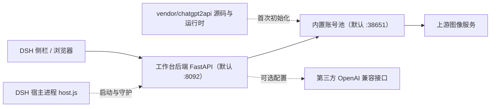

# Bluxe手绘工坊 · 生图工作台

[English](./README.en.md) · 简体中文 · [MIT License](./LICENSE)

面向 DeepSeek Harness（DSH）桌面端的图像生成工作台插件。插件以单一分发包提供 Web 工作台、FastAPI 后端服务与账号池运行时，在 DSH 侧栏中承载图文与摄影两类提示词生成流程。图像接口默认指向插件内置的本地账号池，亦可配置为任意 OpenAI 兼容服务。

后端服务可脱离 DSH 独立运行，默认通过浏览器访问 `http://127.0.0.1:8092/`。

> 本仓库仅包含源代码及内置的图型、风格、版式与配色定义。生成的图片、历史记录、草稿、账号凭据、API Key 与代理配置等运行时数据均不纳入版本管理。

## 目录

- [功能特性](#功能特性)
- [系统架构](#系统架构)
- [运行环境](#运行环境)
- [安装](#安装)
- [首次启动](#首次启动)
- [接口接入与账号管理](#接口接入与账号管理)
- [独立运行](#独立运行)
- [HTTP 接口](#http-接口)
- [数据与隐私](#数据与隐私)
- [故障排查](#故障排查)
- [维护与卸载](#维护与卸载)
- [许可与第三方代码](#许可与第三方代码)

## 功能特性

| 能力 | 说明 |
| --- | --- |
| 双模式提示词 | 图文与摄影两条生成路径，可组合图型、风格、配色与版式；内置 `server/catalog.json`，含 368 项风格、170 项版式、36 项配色 |
| 参考图输入 | 支持上传或拖入参考图，经 `/v1/images/edits` 提交；接口不支持时可关闭该能力 |
| 批量生成 | 批量导入分镜并排队执行。单张失败后自动切换账号重试（最多 3 轮），任务不因局部失败而中断 |
| 画幅比例 | `1:1`、`3:4`、`2:3`、`9:16`、`4:3`、`3:2`、`16:9`，以及 `2.35:1` 公众号封面。上游无对应原生尺寸时，先按最宽尺寸出图，再在本地居中裁剪 |
| 结果管理 | 生成历史、草稿箱、单张重做、ZIP 打包下载、缩略图与预览派生图、任务完成提醒 |
| 运行监控 | 账号总数、可用数、配额、按账号统计的失败记录与任务队列状态；可一键停止当前生图任务 |
| 接口与账号池 | 复制接口地址与本地 API Key；启动、停止、重启账号池并配置掉线自动拉起；导入账号（自动跳过人工剔除过的）、停用与删除账号、轮换密钥 |
| 自定义项 | 工作台名称、图片保存目录、接口名称、模型名、返回格式与监控模式 |

## 系统架构



| 组件 | 职责 |
| --- | --- |
| `host.js` / `client.js` | DSH 宿主侧入口：启动并守护 8092 端口、渲染侧栏面板、提供状态指示 |
| `install.mjs` | 幂等安装器：注册 profile、同步后端代码、卸载时清理注册项 |
| `cordis.patch.yml` | DSH loader 配置：服务端口、守护开关与探测间隔 |
| `server/` | 工作台后端代码、静态界面与图型风格定义 |
| `vendor/chatgpt2api/` | 账号池服务端源码快照、`uv` 运行时、清洗后的默认配置及原始许可证 |
| `scripts/vendor-snapshot.py` | 重新生成 `vendor/` 源码快照 |

账号池的进程生命周期由 `server/pool_service.py` 统一管理，DSH 宿主进程仅负责 8092 端口的工作台后端。账号池运行时随插件分发，不依赖外部账号池插件。

## 运行环境

| 项目 | 要求 |
| --- | --- |
| DSH 桌面端 | 已在 `desktop` profile 验证；DSH 为可选依赖，参见[独立运行](#独立运行) |
| Node.js | 20 及以上，用于执行 `install.mjs` 与 `host.js` |
| Python | 3.13。插件内置 `uv`，首次启动时自动准备运行时与依赖；亦可预装系统 Python 并手动安装 `server/requirements.txt` |
| 操作系统 | Windows 10 / 11 已完成验证。`vendor/chatgpt2api/runtime/uv.exe` 为 Windows 二进制；Linux 与 macOS 需自备 `uv` 或 Python 3.13 运行环境 |
| 网络 | 首次初始化需下载 Python 运行时与依赖包；账号池访问上游服务通常需要配置出网代理 |

## 安装

### 在 DSH 中安装（推荐）

打开「插件 → 添加插件」，三种填法任选一种：

| 方式 | 填什么 | 说明 |
| --- | --- | --- |
| npm 包名（首选） | `dsh-plugin-image-workbench` | 走 CDN，装得快且不会中途断；插件管理器会同时探测 npmjs 与 npmmirror，取先响应的那个 |
| Gitee 镜像 | `https://gitee.com/guohwa/dsh-plugin-image-workbench` | 国内直连，浅克隆实测 9 秒左右 |
| GitHub 原仓库 | `https://github.com/guohwa/dsh-plugin-image-workbench` | 内容源头，国内常卡在 31 MB 的 uv 运行时传输上 |

三处是同源内容：GitHub 上每次 push 和打 tag 会自动镜像到 Gitee，npm 也由 tag 触发发布。插件里带一个约 31 MB 的 uv 运行时，这正是从 GitHub 克隆时最容易超时的那一块，所以国内优先用包名或 Gitee 地址。

### 交给 AI Agent 安装（最省事）

如果你正在使用支持插件安装指令的 AI 助手（如 WorkBuddy），直接把仓库地址丢给它，说一句就行，不用自己敲命令：

> 帮我安装 dsh-plugin-image-workbench 这个 DSH 插件

Agent 会自动执行克隆、运行 `node install.mjs` 并完成 profile 注册，装完提示你重启 DSH。整个过程与下方的[从源码安装](#从源码安装)完全一致，只是由 Agent 代为操作；首次初始化、账号导入与代理配置的步骤仍需你按界面提示完成。

### 从源码安装

适用于开发环境、网络受限或从旧版本迁移：

```bash
git clone https://gitee.com/guohwa/dsh-plugin-image-workbench.git
cd dsh-plugin-image-workbench
node install.mjs
```

上游在 GitHub（`https://github.com/guohwa/dsh-plugin-image-workbench.git`），国内直连更推荐上面这条 Gitee 地址，内容与 GitHub 一致。

安装器会建立 profile 目录联接、注册 bundle、同步后端代码并清理旧版独立号池插件的加载项，可重复执行；安装完成后多数情况下 DSH 会直接加载新 bundle，侧栏未出现入口时完全退出 DSH 再启动一次。

> 安装目录不要移动或删除。profile 中保存的是指向该目录的目录联接，移动后 DSH 将无法解析到插件。需要换位置时，先在原目录执行 `node install.mjs --uninstall`，再在新位置重新安装；安装器也会在重装时自动修正指向旧路径的联接。

侧栏入口为「Bluxe手绘工坊 · 生图工作台」，亦可直接访问 `http://127.0.0.1:8092/`。

## 首次启动

首次启动会自动准备后端与账号池的运行环境，通常 1 分钟内完成，无需手动操作；环境就绪后账号池会自动拉起，也可在「接口与号池 → 本地号池」手动启动。

插件以 `node_modules` 形式安装时，后端代码会同步到 `~/.dsh/image-workbench/server`，号池源码快照同步到同级的 `vendor/`，Python 环境、生成图片、账号与历史数据都留在这个目录里。插件包本身保持只读，升级插件不会冲掉环境和图片。用 `link:` 指向源码目录（开发场景）时不复制，直接用源码目录。

## 接口接入与账号管理

工作台支持两类接入方式：使用你已有的号池或任意第三方 OpenAI 兼容接口（方式 A）、使用本插件内置账号池（方式 B）。首次生成前需完成以下任一配置。

### 方式 A：使用自有号池或者第三方接口

如果你已经在 DSH 中运行着自己的「ChatGPT2API · 号池」（如默认端口 `38650`），或想接入任意 OpenAI 兼容服务，工作台完全兼容，无需启用本插件内置的 `38651` 号池：

1. 在「接口与号池 → 出图接口」中，将 Base URL 填写为你已有号池的 `/v1` 地址（例如 `http://127.0.0.1:38650/v1`），并填入该号池的用户 API Key（在其 `user-api-keys.json` 中可查）。
2. 出图与参考图重写均通过标准 OpenAI 兼容协议（`/v1/images/generations`、`/v1/images/edits`）提交，你的号池原生支持。

> 未配置任何号池就点击「出图」时，工作台会明确提示「尚未配置生图号池」，并指引前往「接口与号池」面板填写地址与 Key，而非笼统报错。

### 方式 B：使用内置账号池

在「接口与号池 → 本地号池」中导入账号。点击文件选择框或拖入 `.txt`、`.json`、`.csv`、`.tsv`、`.log` 等文本文件（可多选），亦可直接粘贴文本内容，然后点击「导入并授权入池」。

| 格式 | 说明 |
| --- | --- |
| JSON 导出 | `{"accounts":[...]}`、数组或单个对象。保留邮箱、密码等账号资料，便于 token 失效后重新登录，推荐使用该格式 |
| 五段式发料 | `email----password----client_id----mail_refresh_token----access_token`。邮箱 Client ID 与邮箱刷新令牌随账号留档，不会被当作号池的 `refresh_token` 使用 |
| 纯文本 token | 每行一个 `access_token`（`eyJ` 开头的长字符串） |
| 传统导出行 | `email,password,token` 或 `email----password----token` |

仅包含邮箱、密码与 2FA 密钥而不含 `access_token` 的条目不在支持范围内，本版本号池不执行登录换取 token 的操作。导入完成后，按网络环境配置出网代理，并确认面板显示在线状态。

> 接口不在内置号池时（例如改指了 `38650`），「本地号池」页会出现「↩ 切回内置池」按钮，一次完成改地址、对齐密钥与启动；外部号池的账号和进程都不受影响。

### 出网代理配置

内置账号池需要访问上游图像服务（OpenAI / ChatGPT）。不受限网络可以留空直连；受限网络按下述方式配置。面板里显示的地址永远是本机实际探测结果，不是写死的示例。

- **自动反显**：「接口与号池 → 本地号池 → 号池出口代理」显示的是本机当前在用的代理。检测顺序为先读 `HTTPS_PROXY` 等环境变量（宿主和工具链注入的临时回环代理会被忽略），再扫本机常见端口：1080（SOCKS5 / HTTP 都试）、7890、7891、8118、1087。换电脑、换代理端口，显示会跟着变。
- **自动校准**：号池启动时校准一次。已保存的地址在本机还能连通就保留；已经连不上（换了机器、端口关了、客户端退出）则重新探测并覆盖；没探测到就回退直连。
- **手动填写 / 一键切换**：也可以直接在输入框里填自己的地址，点「保存代理」立即做连通性校验，不通会指出是哪个地址连不上，通过后自动重拉账号额度。已保存的地址在本机不可用时，面板标出「本机连不上」并给出「改用 <地址>」按钮。
- **环境变量**：启动前设置 `CHATGPT2API_PROXY_RUNTIME_PROXY_URL`（如 `socks5://127.0.0.1:1080`），号池初始化时优先采用。

配置代理后，号池经该出口访问上游，生成任务方可成功；未配置且网络受限时，表现为面板在线但生成失败、日志提示连接超时，账号额度会一直停在 0（界面显示为「已用完」）。

## 独立运行

后端服务可自行启动并守护账号池，因此无需 DSH 亦可运行：

```bash
cd server
python -m venv .venv
```

```bash
# Windows
.venv/Scripts/pip install -r requirements.txt
.venv/Scripts/python -m uvicorn app:app --host 127.0.0.1 --port 8092

# Linux / macOS
# .venv/bin/pip install -r requirements.txt
# .venv/bin/python -m uvicorn app:app --host 127.0.0.1 --port 8092
```

账号池运行时仍由 `pool_service.py` 从插件的 `vendor/` 目录释放。Linux 与 macOS 环境若无可用 `uv`，需预先准备账号池的 Python 3.13 运行环境。启动后访问 `http://127.0.0.1:8092/`。

## HTTP 接口

后端主要路由如下，完整定义见 `server/app.py`。

| 路由 | 方法 | 用途 |
| --- | --- | --- |
| `/health` | GET | 后端存活探测 |
| `/api/catalog` | GET | 图型、风格、版式与配色定义 |
| `/api/config`、`/api/config/test` | GET / POST | 配置读取、更新与连通性测试 |
| `/api/compose` | POST | 提示词合成 |
| `/api/generate` | POST | 提交图像生成任务 |
| `/api/generate/stop` | POST | 中断在途请求、清空排队并停止换号重试 |
| `/api/tasks/{task_id}` | GET | 查询任务状态 |
| `/api/history`、`/api/drafts` | GET / POST / DELETE | 生成历史与草稿 |
| `/api/monitor` | GET | 运行监控数据 |
| `/api/pool/panel` | GET | 账号与密钥概览 |
| `/api/pool/proxy`、`/proxy/test` | GET / POST | 读取、保存与测试号池出口代理（受限网络必填，默认直连） |
| `/api/pool/accounts/import`、`/delete`、`/status` | POST | 账号导入、删除与启停 |
| `/api/pool/key/ensure` | POST | 重新签发用户 API Key |
| `/api/pool/service` | GET | 账号池进程状态 |
| `/api/pool/service/start`、`/stop`、`/restart`、`/auto` | POST | 进程控制与自动拉起开关 |

## 数据与隐私

- `.gitignore` 明确排除 `images/`、`refs/`、`thumbs/`、`workbench/`、`*.db`、`history.json`、`drafts.json`、`config.local.json`、`user-api-keys.json`、`admin-key`、`*.log` 及全部 `*.bak_*` 备份文件。
- 运行时产物均保留在本机：图片、历史与草稿位于 `server/` 下，账号与密钥位于账号池数据目录。
- 两个服务默认仅监听 `127.0.0.1`，后端鉴权层为本地版空实现。**请勿将 8092 或 38651 直接暴露至公网或共享网络**；如需远程访问，应自行配置反向代理与身份认证。
- 账号池会持有导入的账号凭据，不应同步其数据目录至任何公开位置。

## 故障排查

| 现象 | 处理方式 |
| --- | --- |
| 侧栏未出现入口 | bundle 仅在 DSH 启动时加载，完全退出 DSH 再启动 |
| 插件管理器提示连接 GitHub 超时 | 换成 Gitee 地址 `https://gitee.com/guohwa/dsh-plugin-image-workbench`，国内直连 |
| 安装报 `ERR_PNPM_EPERM ... rename '...dsh-plugin-image-workbench_tmp_...'` | 上一个版本还在运行，后端进程把插件目录锁住了，Windows 不允许重命名。完全退出 DSH（托盘菜单 → 退出），在任务管理器结束残留的 `python.exe`，删掉 `node_modules\dsh-plugin-image-workbench` 后重装。1.1.4 起装在 `node_modules` 里时运行时会自动搬到 `~/.dsh/image-workbench`，不再出现 |
| 移动过插件目录后代码不再生效 | 重跑 `node install.mjs`，安装器会把目录联接重建到当前路径 |
| 提示「工作台后端未运行」 | 面板会直接显示原因：多为本机没有 Python 3.10+ 且自动下载失败。装一个 Python 3.13 后点「立即启动并重试」；有代理时插件会自动识别并使用 |
| 装依赖时报 `fastapi was not found in the package registry`，或提示镜像返回 403 | 代理把镜像站拦了。插件会自动换源（镜像直连 → 官方 PyPI 走代理 → 官方直连）；仍失败时可用 `DSH_IMAGE_PYPI_INDEX` 指定一个能直连的源 |
| 反复提示 `No module named uvicorn` | 上一轮装依赖失败留下的空环境。1.1.2 起会自动识别并补装；旧版本可手动删掉 `server/.venv` 后重启 DSH |
| 提示内置账号池未就绪 | 在「接口与号池 → 本地号池」执行启动；首次运行需等待环境初始化完成 |
| 账号额度一直是 0、显示「已用完」 | 出口代理没生效或端口填错。到「本地号池 → 号池出口代理」重新填写并保存，保存时会校验连通性；校验通过后额度会自动重算 |
| 生成请求返回 401 | 在面板中重新签发 API Key，或核对第三方接口的密钥 |
| 账号池在线但生成失败 | 通常为出网代理未配置或账号额度耗尽；检查 `source/config.json` 中的代理设置与 `pool-service.log` |
| 修改宿主侧代码或 profile 配置 | 需重启 DSH；仅修改静态界面资源时刷新浏览器缓存即可 |
| 侧栏仍显示旧版账号池入口 | 安装器已清理其加载清单注册项，重启 DSH 后移除 |

## 维护与卸载

```bash
# 修改本机账号池源码后重新生成 vendor 快照，不包含账号与密钥
python scripts/vendor-snapshot.py

# 后端接口冒烟测试，使用已安装依赖的 Python 执行
cd server && python smoke_check.py --quick

# 更新：把新版本源码覆盖到原目录（或用 Git 拉取），再重跑安装器
node install.mjs

# 从 profile 摘除插件并断开目录联接，重启 DSH 生效
node install.mjs --uninstall
```

卸载只移除 profile 注册项与目录联接，插件源码目录、`~/.dsh/chatgpt2api-image` 中的账号数据与生成结果均保留，确认不再需要时可自行删除。

账号池采用严格轮询选号，并排除处于限流状态的账号；单账号失败会在监控中记录，不会中断批量任务。进程启动、停止、重启与自动拉起控件仅作用于当前 Base URL 指向的本机账号池，配置第三方接口时隐藏。

## 许可与第三方代码

本仓库自研代码采用 [MIT License](./LICENSE)。内置账号池的服务端代码来自以下上游项目：

| 层级 | 项目 |
| --- | --- |
| 后端上游 | [basketikun/chatgpt2api](https://github.com/basketikun/chatgpt2api)（`VERSION` = 1.8.0） |
| DSH 插件封装 | [yang0/chatgpt2api-dsh](https://github.com/yang0/chatgpt2api-dsh) |
| 本仓库 | `vendor/chatgpt2api/`，仅后端源码快照 |

快照依 MIT 分发，Copyright (c) 2026 kunkun，许可证原文见 `vendor/chatgpt2api/source/LICENSE`；含轮询游标持久化与限流账号排除两处补丁，不含账号、密钥与代理配置。

上游项目对其使用范围另有声明，请自行阅读。本仓库不提供账号。
