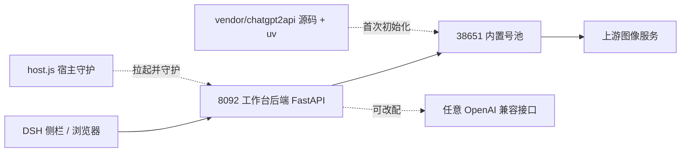

# Bluxe手绘工坊 · 生图工作台（DSH 插件）

[English](./README.en.md) · 简体中文

一个插件跑全套：把图文 / 摄影两种生图工作台挂进 DeepSeek Harness（DSH）侧栏。号池服务端运行时随插件自带，装完不需要再装第二个号池插件；出图接口也可以换成任意 OpenAI 兼容服务（Base URL / API Key / 模型）。

工作台后端脱离 DSH 也能跑，浏览器直接打开 `http://127.0.0.1:8092/` 即可。

> 本仓库只有代码和内置的图型风格定义，不含生成过的图片、历史记录、草稿、账号、token、密钥或代理配置。

## 功能

| 模块 | 说明 |
| --- | --- |
| 双模式出图 | 图文 / 摄影两种提示词生成路径，可切图型、风格、配色、版式；内置 `server/catalog.json` 含 368 条风格、170 条版式、36 条配色 |
| 参考图 | 上传或拖入参考图，走 `/v1/images/edits`；接口不支持时可关掉该能力 |
| 批量出图 | 批量导入分镜、排队生成；单张失败自动换号重试（最多 3 轮），任务不会因为一张图失败而中断 |
| 出图比例 | `1:1`、`3:4`、`2:3`、`9:16`、`4:3`、`3:2`、`16:9`，以及 `2.35:1` 公众号封面（上游无原生尺寸，先按最宽出图再本地居中裁剪） |
| 结果管理 | 生成历史、草稿箱、单张退出重做、打包下载 ZIP、缩略图与预览派生图、出图完成气泡提醒 |
| 运行监控 | 账号数 / 可用数 / 配额、账号失败账本、任务队列状态 |
| 接口与号池 | 一键复制接口地址与本地明文 API Key；启动 / 停止 / 重启号池、掉线自动拉起；粘贴 JSON 或裸 token 导入账号、停用 / 删除账号、重新生成 Key |
| 自定义 | 工作台名称、生成图片保存目录、接口名称、模型名、返回格式、监控模式 |

## 结构



| 路径 | 内容 |
| --- | --- |
| `host.js` / `client.js` | DSH 宿主侧：拉起并守护 8092、侧栏面板、状态指示灯 |
| `install.mjs` | 幂等安装脚本：挂载 profile、同步后端代码、摘除旧独立号池插件 |
| `cordis.patch.yml` | DSH loader 配置（端口、守护间隔） |
| `server/` | 工作台后端纯代码副本：`app.py`、`pool.py`、`pool_service.py`、`pool_admin.py`、`static/index.html`、`catalog.json` |
| `vendor/chatgpt2api/` | 号池服务端源码快照 + `runtime/uv.exe` + MIT LICENSE + 清洗后的出厂配置 |
| `scripts/vendor-snapshot.py` | 重新打包号池源码的脚本 |

号池的所有权和进程生命周期都在 `server/pool_service.py`，宿主只负责 8092。`38650` 上的写作台号池属于另一套插件，本工作台不会启动、停止或改写它。

## 快速开始

### 前置条件

| 条件 | 说明 |
| --- | --- |
| DSH 桌面端 | 在 `desktop` profile 上验证；也可以跳过 DSH，见「独立运行」 |
| Node.js >= 20 | 运行 `install.mjs` 与 `host.js` |
| Python | 插件自带 `uv.exe`，首次启动会准备 Python 3.13 与依赖；也可回退到系统 Python（需自行安装 `server/requirements.txt`） |
| 网络 | 首次初始化要联网取 Python 与 pip 包；号池访问上游通常需要自己配代理 |
| 操作系统 | Windows 10 / 11 已实测。`vendor` 里的 `uv.exe` 是 Windows 二进制，Linux / macOS 需自备 uv 或系统 Python 环境 |

### 安装

```bash
git clone https://github.com/guohwa/dsh-plugin-image-workbench.git
cd dsh-plugin-image-workbench
node install.mjs
```

`install.mjs` 做四件事：备份并更新 `~/.dsh/profiles/desktop/package.json` 的 `dependencies` 与 `dsh.profile.bundles`、同步 `pnpm-lock.yaml`、在 profile 的 `node_modules` 下建立指向插件目录的联接、把旧独立号池插件 `dsh-plugin-image-pool` 从加载清单里摘掉（只改配置，不删它的源码和账号数据）。脚本幂等，重复执行不会重复写入。

**重启 DSH**，bundle 才会加载。侧栏出现「Bluxe手绘工坊 · 生图工作台」后点开，或直接在浏览器打开 `http://127.0.0.1:8092/`。

插件目录请保留在原位，它是以目录联接方式挂进 profile 的；移动之后重跑一次 `node install.mjs` 即可。

### 首次启动会自动完成

1. 从 `vendor/chatgpt2api/` 释放号池源码到本机数据目录，不复制任何账号库；
2. 用插件自带 uv 执行 `sync --frozen --no-dev` 建号池虚拟环境，再给工作台后端建环境（清华 PyPI 镜像）；
3. 启动 `127.0.0.1:38651`，生成 `admin-key` 与首把用户 API Key；
4. 号池起来后主动对账，页头统计不会先停在「1 号 / 配额 0」；
5. 开启两条守护：宿主每 15 秒探 8092，后端每 15 秒探 38651，掉线自动拉起，不重载页面。

首次初始化约 20 秒到 1 分钟，取决于本机是否已有 Python 3.13 缓存。

### 出图前必须二选一

全新号池**没有任何账号**，直接点生成会失败。选一条：

**A. 用内置号池**

打开「接口与号池 → 本地号池」，把账号贴进导入框并导入，格式支持：

- 号池 / 第三方工具导出的 JSON（`{"accounts":[...]}`、数组或单个对象），推荐，会连邮箱、密码等资料一起带上，token 过期后能自动重登；
- 每行一个 `access_token`（`eyJ` 开头的长串）；
- 老式导出行（邮箱,密码,token 或 `邮箱----密码----token`）。

再按自己的网络环境配好出网代理，确认面板显示在线，就可以出图。

**B. 用第三方接口**

打开「接口与号池 → 出图接口」，填 Base URL / API Key / 模型，保存并试连。这条路径不需要启动内置号池。

## 独立运行（不装 DSH）

工作台后端自己会拉起并守护号池，所以可以只起后端：

```bash
cd server
python -m venv .venv
# Windows
.venv/Scripts/pip install -r requirements.txt
.venv/Scripts/python -m uvicorn app:app --host 127.0.0.1 --port 8092
# Linux / macOS
# .venv/bin/pip install -r requirements.txt
# .venv/bin/python -m uvicorn app:app --host 127.0.0.1 --port 8092
```

号池运行时仍由 `pool_service.py` 从插件 `vendor/` 释放并用自带 uv 初始化。Linux / macOS 若没有可用的 uv，需要先准备号池的 Python 3.13 环境。打开 `http://127.0.0.1:8092/` 即可使用。

## 配置

页面里的「接口与号池 → 出图接口」可以改大部分项，落盘到 `server/config.local.json`（该文件不会入库）。

| 项 | 默认值 | 改法 |
| --- | --- | --- |
| 工作台端口 | `8092` | `cordis.patch.yml` 的 `port`，或环境变量 `DSH_IMAGE_PORT` |
| 号池端口 | `38651` | `cordis.patch.yml` 的 `poolPort`，或环境变量 `DSH_IMAGE_POOL_PORT` |
| 接口地址 | `http://127.0.0.1:38651/v1` | 页面「出图接口」页签 |
| 图像模型 | `gpt-image-2` | 页面「出图接口」页签 |
| 图片保存目录 | `server/images/` | 页面「出图接口」页签，可填绝对路径 |
| 工作台名称 | `Bluxe手绘工坊 · 生图工作台` | 页面「出图接口」页签 |
| 号池数据目录 | `~/.dsh/chatgpt2api-image/` | 页面「本地号池」页签的目录提示；`admin-key`、`user-api-keys.json`、`source/config.json`、账号库都在这里 |
| 守护间隔 | `15000` ms | `cordis.patch.yml` 的 `watchdogIntervalMs`；`watchdog: false` 可关掉宿主守护 |
| 日志 | `~/.dsh/image-workbench/backend.log`、`~/.dsh/image-workbench/venv.log`、号池目录的 `pool-service.log` | 排障先看这三处 |

## 号池账号与出网

- 面板里的「启动 / 停止 / 重启 / 掉线自动拉起」只作用于当前 Base URL 指向的本机号池；换成第三方接口后，这些控件不会出现。
- 号池出厂配置 `vendor/chatgpt2api/source/config.default.json` 把 `auth-key`、`proxy`、`proxy_runtime.proxy_url` 等全部清空了。首次初始化后，按自己的网络环境编辑 `~/.dsh/chatgpt2api-image/source/config.json` 的 `proxy` 或 `proxy_runtime`，否则号池在线也调不通上游。
- 号池内置严格 round-robin 选号，并对「限流」状态做了排除；单号失败会在监控里记一条，不会让整个批量任务中断。
- 本地明文 API Key 只在本机号池目录与页面上显示，浏览器拿不到号池账号的 `access_token` 明文，只用摘要 id 操作。

## 数据与隐私

- 仓库通过 `.gitignore` 明确排除 `images/`、`refs/`、`thumbs/`、`workbench/`、`*.db`、`history.json`、`drafts.json`、`config.local.json`、`user-api-keys.json`、`admin-key`、`*.log` 和所有 `*.bak_*` 备份。
- 运行时生成的一切都留在本机：图片、历史、草稿在 `server/` 下，账号与密钥在号池数据目录。
- 两个服务默认只监听 `127.0.0.1`，后端鉴权层是本地版空实现。**不要把 8092 / 38651 直接暴露到公网或局域网**；需要远程访问请自行套反向代理与认证。
- 号池会持有你导入的账号凭据，请勿把号池数据目录同步到公开位置。

## 常见问题

| 现象 | 处理 |
| --- | --- |
| 侧栏没有入口 | bundle 只在 DSH 启动时加载，重启 DSH |
| 提示「内置号池未就绪」 | 打开「接口与号池 → 本地号池」点「启动号池」；首次要建环境，等 1 分钟 |
| 生成返回 401 | 面板里点「重新生成」Key，或核对第三方接口的 API Key |
| 号池显示在线但生成失败 | 多为代理未配或账号额度用尽，先导入账号、配 `source/config.json` 的代理，再看 `pool-service.log` |
| 改了 `host.js` / `client.js` / `package.json` | 必须重启 DSH 才生效；只改 `static/index.html` 时刷新页面（Ctrl+F5）即可 |
| 装完侧栏还留着旧号池入口 | `install.mjs` 已从加载清单摘掉，重启 DSH 后消失 |

## 升级号池源码与卸载

```bash
# 改完本机号池源码后重新生成 vendor 快照（不含账号与密钥）
python scripts/vendor-snapshot.py

# 从 profile 摘掉本插件，重启 DSH 生效；数据目录不会被删除
node install.mjs --uninstall
```

后端自测：在 `server/` 目录下用已装好依赖的 Python 运行 `python smoke_check.py --quick`。

## 第三方代码与许可

`vendor/chatgpt2api/` 是 ChatGPT2API v1.8.0 的服务端代码快照，MIT License，Copyright (c) 2026 kunkun，许可证原文见 `vendor/chatgpt2api/source/LICENSE`。快照里保留了两处工作台所需补丁：round-robin 游标持久化、限流账号排除。它只提供「能跑起来的代码」，账号、密钥、代理配置一律不带。

本仓库自研部分尚未单独声明许可证；再次分发时请保留 vendor 目录内的 MIT 版权声明。

上游仓库与账号来源由使用者自行确认合规性，本项目不提供任何账号。
